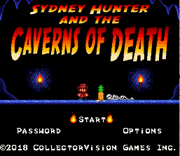
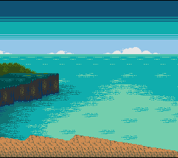
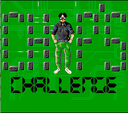
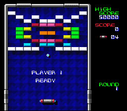
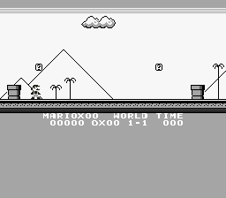

# Make games for the Super Nintendo.

PVSnesLib is a development library for creating homebrew games and applications for the Super Nintendo Entertainment System.

  <a class="md-button md-button--primary" href="getting-started/installation/">Get started</a>
  <a class="md-button" href="https://github.com/alekmaul/pvsneslib">View on GitHub</a>

  <a class="home-feature" href="getting-started/">
    <strong>Get started</strong>
    Set up your toolchain and build your first SNES project.
  </a>
  <a class="home-feature" href="tutorials/">
    <strong>Guides</strong>
    Explore practical tutorials for graphics, sprites, input and audio.
  </a>
  <a class="home-feature" href="https://alekmaul.github.io/pvsneslib/">
    <strong>API reference</strong>
    Browse the generated Doxygen documentation.
  </a>

## Games made with PVSnesLib

A few projects created with the library. These games are showcases; their source code is not included here.

  <article class="game-showcase-card">
    
    

      <strong>Sydney Cod</strong>
      A game made with PVSnesLib.
    

  </article>
  <article class="game-showcase-card">
    
    

      <strong>Eyra</strong>
      A game made with PVSnesLib.
    

  </article>
  <article class="game-showcase-card">
    
    

      <strong>Chip Challenge</strong>
      A game made with PVSnesLib.
    

  </article>

## Learn from the source

These example games are included in the PVSnesLib repository. Explore their source code and use them to understand how a complete game is structured.

  <article class="game-showcase-card">
    
    

      <strong>Breakout</strong>
      Study a complete Breakout-style game.
      <a href="https://github.com/alekmaul/pvsneslib/tree/master/snes-examples/systems/games">Browse game example sources</a>
    

  </article>
  <article class="game-showcase-card">
    
    

      <strong>LikeMario</strong>
      Explore a platform-game example.
      <a href="https://github.com/alekmaul/pvsneslib/tree/master/snes-examples/systems/games">Browse game example sources</a>
    

  </article>

## Explore all examples

The community-maintained Wiki gallery brings together screenshots and information about many projects and examples made with PVSnesLib.

  <a class="md-button" href="https://github.com/alekmaul/pvsneslib/wiki/Examples-gallery">Explore the examples gallery</a>

## Start building

Follow the getting-started guide, then explore the tutorials and examples to create your own SNES projects.
