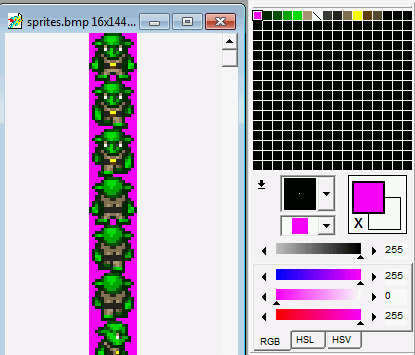
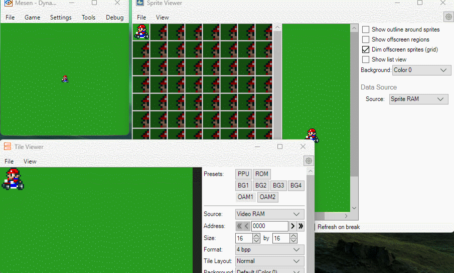
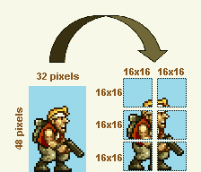

# Sprites

This guide introduces the sprite workflow used by PVSnesLib: preparing graphics and palettes, placing hardware sprites through OAM, moving them, and organizing larger objects with dynamic sprites or metasprites.

For the community-maintained tutorials, see the [PVSnesLib Wiki — Sprites](https://github.com/alekmaul/pvsneslib/wiki/Sprites), [Dynamic Sprites](https://github.com/alekmaul/pvsneslib/wiki/Dynamic-Sprites), and [Meta Sprites](https://github.com/alekmaul/pvsneslib/wiki/Meta-Sprites).

## Sprite graphics and transparency

Sprite graphics are prepared as tile data and uploaded to VRAM. Palette design matters: the first color in a sprite palette is used as the transparent color. The Wiki recommends checking the palette if imported graphics display unexpected colors.



The repository's sprite examples use `gfx4snes` to convert graphics resources for the SNES. Keep the conversion settings, tile layout, and palette arrangement consistent with the way the sprite is drawn in your program.

## OAM: displaying a sprite

The SNES uses Object Attribute Memory (OAM) to describe hardware sprites. PVSnesLib provides helpers such as `oamSet()`, `oamSetEx()` and `oamSetVisible()`.

**Important: OAM helper IDs are byte offsets, not plain sprite numbers.** The header documents IDs from `0` to `127`, multiplied by 4. Use `0`, `4`, `8`, and so on for consecutive sprites. The repository examples follow this convention; for example, the Super Scope example computes IDs with `i << 2`.

The `oamSet()` function takes the sprite ID, X and Y position, priority, horizontal flip, vertical flip, graphics tile offset, and palette offset:

```c
oamSet(0, x, y, 3, flipx, 0, gfx_frame, 0);
oamSetEx(0, OBJ_SMALL, OBJ_SHOW);
```

`oamSetEx()` sets the sprite size and visibility. `oamSetVisible()` can change visibility separately. Note that the library's `OBJ_HIDE` behavior moves the sprite to X=255, Y=240; when showing it again, restore its coordinates with `oamSetXY()`. If you need to hide a sprite without losing its coordinates, the header recommends setting its graphics offset to a transparent tile instead.

## Moving and animating sprites

A sprite can be moved by updating its coordinates with `oamSet()` or by using `oamSetXY()` when only the position changes.

The repository's `graphics/Sprites/AnimatedSprite` example reads the controller state with `padsCurrent(0)`, updates the character position and animation state, selects the corresponding graphic frame, then updates OAM. It waits for VBlank in the main loop; the library's VBlank handling transfers the OAM buffer to hardware.

```c
pad0 = padsCurrent(0);

if (pad0 & KEY_LEFT) {
    if (monster.x >= SCREEN_LEFT)
        monster.x--;
    monster.state = W_LEFT;
    monster.flipx = 1;
}

monster.gfx_frame =
    sprTiles[monster.anim_frame + monster.state * FRAMES_PER_ANIMATION];

oamSet(0, monster.x, monster.y, 3, monster.flipx, 0, monster.gfx_frame, 0);
WaitForVBlank();
```

This is an excerpt from the workflow in the repository example, not a complete standalone program. Use the full example for declarations, animation timing, bounds checks and resource initialization.

## Dynamic sprites

The Dynamic Sprites tutorial demonstrates a workflow for managing sprite graphics dynamically. Its animated viewer illustrates the result and is useful alongside the explanation in the Wiki.



See the [Dynamic Sprites Wiki page](https://github.com/alekmaul/pvsneslib/wiki/Dynamic-Sprites) for the full procedure and the associated example.

## Metasprites

A metasprite is a logical object composed of multiple hardware sprites. This lets a larger character or object be assembled from smaller SNES sprite elements.



The [Meta Sprites Wiki page](https://github.com/alekmaul/pvsneslib/wiki/Meta-Sprites) explains the construction and use of metasprites, with examples. Refer to it when implementing the component layout and offsets for your own objects.

## Related examples

The supplied repository contains working sprite examples under `snes-examples/graphics/Sprites`, including `SimpleSprite`, `AnimatedSprite` and `ObjectSize`. Compare their resource conversion, initialization, OAM IDs and frame timing with the concepts above.

- [PVSnesLib source repository](https://github.com/alekmaul/pvsneslib)
- [Sprites Wiki](https://github.com/alekmaul/pvsneslib/wiki/Sprites)
- [Dynamic Sprites Wiki](https://github.com/alekmaul/pvsneslib/wiki/Dynamic-Sprites)
- [Meta Sprites Wiki](https://github.com/alekmaul/pvsneslib/wiki/Meta-Sprites)
